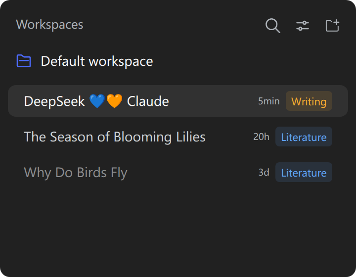
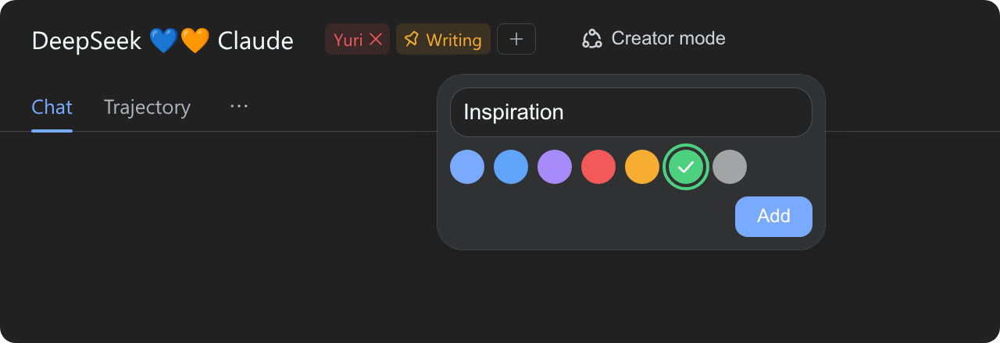

# Session Tags in DSH

_**English** | [简体中文](README.zh-CN.md)_

A [DeepSeek Harness](https://github.com/deepseek-ai/deepseek-harness) (`dsh`) plugin that adds colored tags to sessions, shown in the session list and next to the title of the session detail. Add, remove, and reorder tags, and click a tag to pin it to the sidebar.

## Screenshots

| Session list | Session detail |
| --- | --- |
|  |  |

## Install

Use `--profile web` for a `dsh web` server or `--profile desktop` for the desktop app, then restart the Harness.

```bash
# npm
dsh plugin --profile web add dsh-session-tags
# GitHub (latest)
dsh plugin --profile web add github:Cnily03/dsh-session-tags
```

The desktop app can also install it from its built-in plugin market.

## Usage

Tags render in two places, both reading the same shared store:

- **Sidebar row**: the session's pinned tags follow the row's time as plain quiet chips without the pin glyph. The row's own click-to-open and drag-to-reorder keep working through them.
- **Conversation header**: every tag follows the title. The trailing outline tag opens a panel painted with the shipped menu surface tokens (translucent fill, backdrop blur, elevation). It is anchored under the button and fixed on the page once it opens. Enter adds (IME-safe), Escape closes, and the panel stays open for adding several tags in a row.
- **Pinning**: a pinned header tag leads with the shipped pin glyph, and the tag appears on the session's sidebar row as a plain chip. Clicking again unpins it. Dragging a chip reorders without toggling.
- **Removing**: hover a header tag and the chip reveals an inline × on its right. One click removes it.
- **Reordering**: drag any header tag onto another. A side marker shows where it will land.
- **Live sync**: every edit publishes locally before the POST, so the sidebar row and the header re-render together without a round trip.

Both surfaces reuse the shipped `Tooltip` and `Input` primitives and the theme's static color tokens, so the chips match the native controls and read correctly in light and dark themes.

## Where the tags live

Tags persist on the Host side in a `session_tags` storage domain. It is a schema-validated, durable JSON unit that the Harness keeps under its configured storage root, so tags survive restarts and follow the profile. Each Session's list is capped at 32 tags with 1–32 character labels. When a Session is deleted (its log and live Agent are both gone), a startup sweep removes its record, so deleted Sessions leave no tags behind.

Edits sync live within one client. The Harness's Host-to-client push channel is closed to plugins, so a second browser tab sees new tags after a refresh.

## Develop

```bash
pnpm install
pnpm build        # tsup -> dist/
pnpm typecheck    # tsc --noEmit
pnpm lint         # biome lint
pnpm format       # biome check --write
```

| Path | Purpose |
| --- | --- |
| `src/index.ts` | Host half: `session_tags` storage domain, list/set routes, startup sweep. |
| `src/client.ts` | Client half: row and header tag clusters, add popover, drag reorder, optimistic saves. |
| `src/tag-store.ts` | The shared observable tag map both surfaces subscribe to. |
| `src/styles.ts` | The chip, popover, and drag-marker stylesheet over theme tokens. |
| `src/schema.ts` | The zod-shaped record validator the storage domain reads. |
| `src/locale.ts` | Namespace, routes, palette, limits, and message dictionaries. |
| `cordis.patch.yml` | Bundle patch that inserts the Host row. |

## License

Copyright (c) Cnily03. All rights reserved.

Licensed under the [MIT License](LICENSE).
