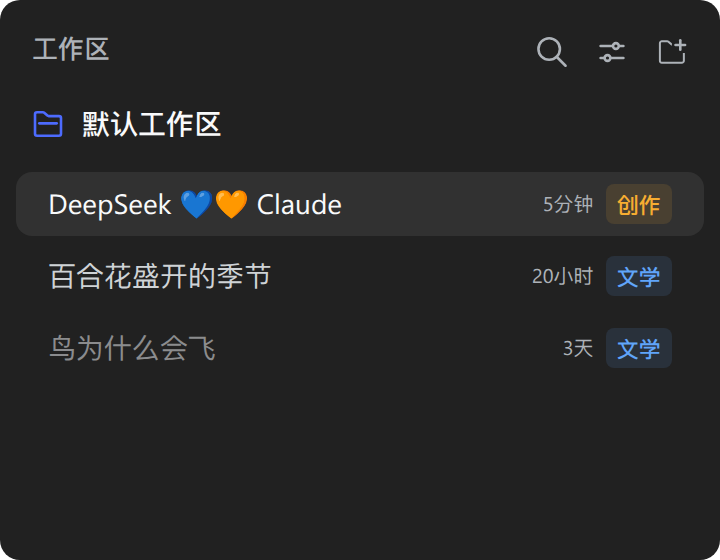
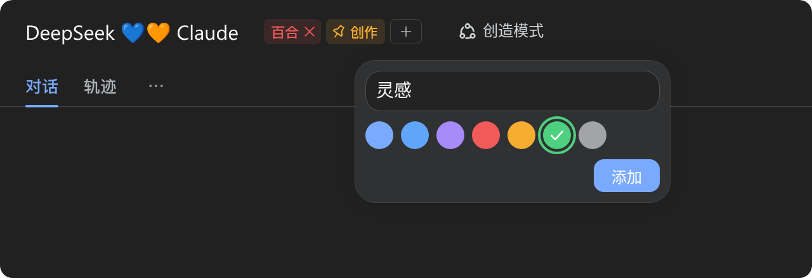

# 在 DSH 中为会话打标签

_[English](README.md) | **简体中文**_

一个 [DeepSeek Harness](https://github.com/deepseek-ai/deepseek-harness)（`dsh`）插件，为工作区会话展示彩色标签——位于侧栏会话行的时间右侧，以及会话详情页标题的右侧。标题右侧的标签可编辑：最末的边框加号标签从七种预设色中选择并输入文字来新增标签，悬停标签会在其内部右侧出现移除按钮，标签支持拖动排序，每次编辑都会实时同步到会话列表。点击标签即固定——标签前出现图钉图标，且只有固定的标签会出现在侧栏会话行。

## 截图

| 侧栏行的标签 | 详情页编辑 |
| --- | --- |
|  |  |

## 安装

web 部署用 `--profile web`，桌面应用用 `--profile desktop`，装好后重启 Harness。

```bash
# npm
dsh plugin --profile web add dsh-session-tags
# GitHub（最新）
dsh plugin --profile web add github:Cnily03/dsh-session-tags
```

桌面应用也可以直接从内置插件市场安装。

## 用法

标签渲染在两处，读取同一个共享 store：

- **侧栏行** —— 已固定的标签紧随行内时间之后，只读的纯浅色标签（不带图钉）；行自身的点击打开与拖动排序不受影响。
- **详情页标题右侧** —— 全部标签紧随标题。最末的边框加号标签打开一个采用原生菜单表面样式（半透明磨砂填充、背景模糊、原生投影）的面板：锚定在按钮下方，打开后固定在页面不再跟随。内含一个文字输入框、七个预设色板与添加按钮；回车即添加（输入法安全），Esc 关闭，面板保持打开以便连续添加多个标签。
- **固定** —— 详情页的固定标签前面带原生图钉图标，同时该标签以纯浅色标签出现在侧栏会话行；再次点击取消固定。拖动标签只排序、不切换固定。
- **移除** —— 悬停标题右侧的某个标签，标签内部右侧出现内联的 ×，点击一次即移除。
- **排序** —— 把任意标签拖到另一个标签上，侧边指示线标出落点。
- **实时同步** —— 每次编辑先本地发布再 POST，侧栏行与详情页一起重新渲染，无需等待往返。

两处都复用宿主的 `Tooltip` 与 `Input` 原语和主题的静态色板 token，因此标签与原生控件一致，且在深浅色主题下都清晰可读。

## 标签存在哪里

标签持久化在宿主侧的 `session_tags` 存储域中——一个由 Harness 管理、经 schema 校验、原子落盘的 JSON 单元，位于配置的存储根目录之下——因此重启不会丢失，并跟随 profile。每个会话最多 32 个标签，文字限 1–32 字符。会话被删除后（日志与活跃 Agent 都不存在时），启动清扫会移除它的记录，已删除的会话不会留下标签。

编辑在同一客户端内实时同步。Harness 的宿主到客户端推送通道对插件关闭，因此第二个浏览器标签页需刷新后才能看到新标签。

## 开发

```bash
pnpm install
pnpm build        # tsup -> dist/
pnpm typecheck    # tsc --noEmit
pnpm lint         # biome lint
pnpm format       # biome check --write
```

| 路径 | 用途 |
| --- | --- |
| `src/index.ts` | Host 半部分：`session_tags` 存储域、读取/写入路由、启动清扫。 |
| `src/client.ts` | Client 半部分：行与标题的标签簇、新增弹层、拖动排序、乐观保存。 |
| `src/tag-store.ts` | 两处界面共同订阅的共享可观察标签映射。 |
| `src/styles.ts` | 基于主题 token 的标签、弹层与拖动指示样式。 |
| `src/schema.ts` | 存储域读取的 zod 形状记录校验器。 |
| `src/locale.ts` | 命名空间、路由、色板、限制与消息词典。 |
| `cordis.patch.yml` | 插入 Host 行的 bundle 补丁。 |

## License

Copyright (c) Cnily03. All rights reserved.

Licensed under the [MIT License](LICENSE).
